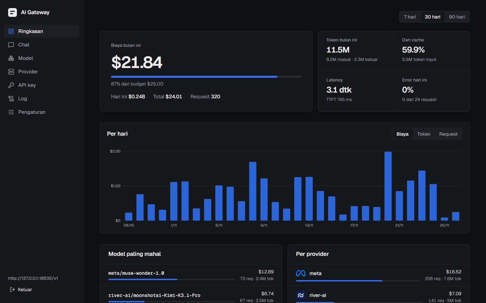
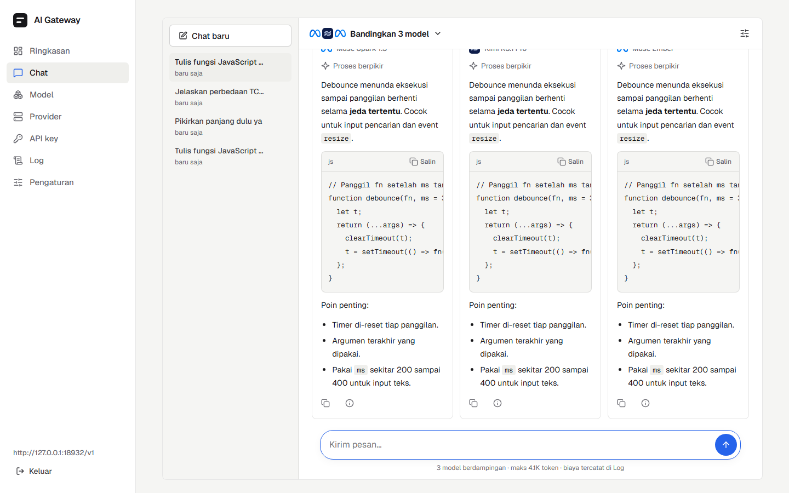
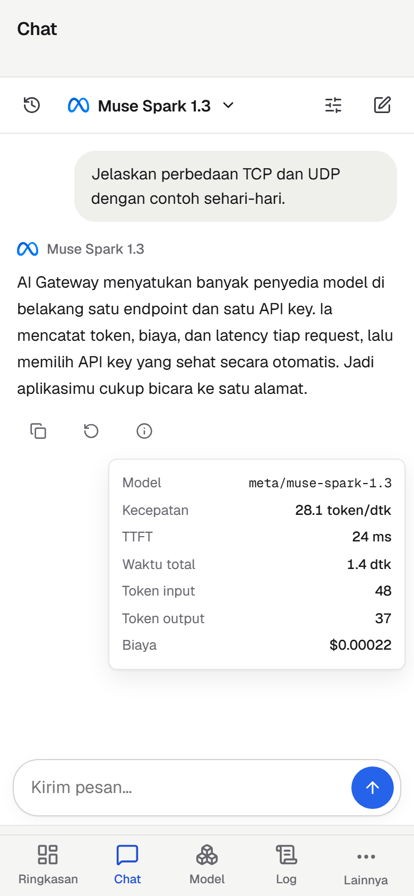
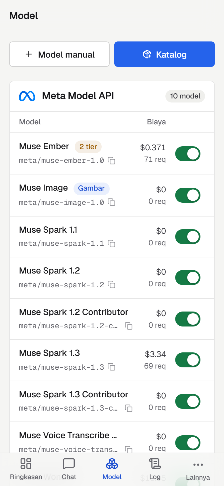

<div align="center">

# AI Gateway

**Self-hosted, OpenAI-compatible AI Gateway** — one endpoint, one API key, multiple AI providers, zero frontend build step, and a single SQLite file.

[](https://nodejs.org)
[](https://hono.dev)
[](https://www.sqlite.org)
[](#testing)

</div>

---

AI Gateway puts all your AI providers behind a single **OpenAI-compatible `/v1` API** with automatic **fill-first account/key pooling**, **quota-aware auto-cooldown**, **per-request token & cost tracking** (including reasoning tokens, images, audio seconds, video frames, and web search), and a fast **vanilla JS/CSS dashboard** that feels native on both desktop and mobile.

## Preview

### Desktop — Overview (Dark) & Side-by-Side Model Comparison
<p align="center">
  
</p>
<p align="center">
  
</p>

### Mobile — Chat Metrics & Model Catalog
<p align="center">
  
  &nbsp;&nbsp;
  
</p>

---

## Highlights

- **Drop-in OpenAI Compatibility**: Works out of the box with official OpenAI Python/Node SDKs, Cursor, Cline, n8n, or `curl`.
  - `POST /v1/chat/completions` (streaming + `delta.reasoning_content`, tool calls)
  - `POST /v1/responses` (Responses API + streaming)
  - `POST /v1/images/generations` & `POST /v1/images/edits` (JSON & multipart)
  - `POST /v1/audio/transcriptions` (OpenAI multipart `json` / `text` / `verbose_json` adapter) + native `/v1/asr/transcribe` & WebSocket `/v1/asr/realtime`
  - `GET /v1/models` & `GET /v1/models/{model}` (with `supported_endpoints` and `pricing` from a single source of truth)
  - `GET /models.md` — clean public Markdown catalog for sharing with users or agents
- **Multi-Provider Support**:
  - **Direct API Key Providers**: Meta Model API (Muse Wonder/Spark/Ember, Muse Image, Muse Voice Transcribe, SAM 3.1), River (DeepSeek, Kimi, Qwen, GLM, Nemotron — with live pricing sync), plus any custom OpenAI-compatible provider.
  - **Subscription-to-API (OAuth, personal use)**: ChatGPT Codex (`GPT-6.2/6.1/6/5.6` + `GPT Image`) and Google Antigravity (`Gemini 4/3.8/3/2.5` + `Gemini 3.1 Flash Image`), unified under the exact same `reasoning_effort` parameter, with live quota inspection and equivalent API cost estimation.
- **Fill-First Key & Account Pool**:
  - Uses the top healthy key/account first to maximize upstream **prompt cache hit rates**.
  - Automatically fails over on `429` (per-key/model cooldown with reset timestamp parsing), `402` (`exhausted`), `401/403` (`invalid`), or proactively via **quota-based auto-cooldown** before hitting `429`.
  - Encrypted at rest with **AES-256-GCM** (`APP_SECRET`).
- **Built-in Playground & Analytics Dashboard**:
  - Chat UI with local history, **compare up to 4 models side-by-side**, streaming Markdown + collapsible thinking box, and per-reply speed (`tok/s`), TTFT, token, and cost metrics.
  - Daily/monthly spend charts, cache hit rate, latency/TTFT, error rate, CSV log export, and hard daily/monthly budget caps.
  - **Zero frontend build step** — pure HTML/CSS/ESM JS with automatic content-hash asset versioning (`?v=hash`).

---

## Quick Start

**Requirements:** Node.js `>= 22`

```bash
git clone https://github.com/wsprfme/ai-gateway.git
cd ai-gateway
npm install
cp .env.example .env
```

Edit `.env` and set `ADMIN_PASSWORD` and a random `APP_SECRET` (minimum 16 characters — **keep it safe**, it encrypts stored provider credentials).

```bash
npm start
```

Open `http://localhost:8787`, sign in, install a provider catalog or add your own provider, and generate a gateway API key (`sk-gw-...`).

---

## Usage Examples

### Chat & Reasoning (Python OpenAI SDK)

```python
from openai import OpenAI

client = OpenAI(
    base_url="http://localhost:8787/v1",
    api_key="sk-gw-...",
)

res = client.chat.completions.create(
    model="codex/gpt-6.2-sol",  # or "antigravity/gemini-4-hydrogen", "meta/muse-spark-1.3", "river-ai/GLM-5.3"
    reasoning_effort="medium",
    messages=[{"role": "user", "content": "Explain prompt caching in 2 sentences."}],
)
print(res.choices[0].message.content)
```

### Image Generation

```python
img = client.images.generate(
    model="codex/gpt-image-2.5",  # or "antigravity/gemini-3.1-flash-image", "meta/muse-image-1.0"
    prompt="A minimal isometric server rack on a clean light background",
)
```

### Audio Transcription

```python
with open("sample.wav", "rb") as f:
    tr = client.audio.transcriptions.create(
        model="meta/muse-voice-transcribe-1.0",
        file=f,
        language="en",
        response_format="verbose_json",
    )
print(tr.text)
```

### Model Discovery

```bash
curl -H "Authorization: Bearer sk-gw-..." http://localhost:8787/v1/models
curl -H "Authorization: Bearer sk-gw-..." http://localhost:8787/v1/models/codex/gpt-6.2-sol
curl http://localhost:8787/models.md
```

---

## Architecture & Stack

| Layer | Technology |
|---|---|
| Runtime | Node.js ≥ 22 (ESM) |
| HTTP & WebSocket | [Hono](https://hono.dev) + `@hono/node-server` + `ws` |
| Database | SQLite via `better-sqlite3` (single file in `data/gateway.db`) |
| Encryption | AES-256-GCM (`node:crypto`) |
| Frontend | Vanilla JS + CSS (no bundler, Geist font, bundled SVG icons) |

---

## Deployment

### Linux VPS (PM2 + Nginx)

```bash
npm install --omit=dev
npm install -g pm2
pm2 start src/server.js --name ai-gateway
pm2 save && pm2 startup
```

Disable proxy buffering in Nginx for smooth SSE streaming:

```nginx
location / {
    proxy_pass http://127.0.0.1:8787;
    proxy_http_version 1.1;
    proxy_buffering off;
    proxy_read_timeout 600s;
    proxy_set_header Host $host;
    proxy_set_header X-Forwarded-For $remote_addr;
    proxy_set_header X-Forwarded-Proto $scheme;
}
```

### cPanel (Setup Node.js App)

Set Node.js `22+`, startup file `app.cjs`, configure `ADMIN_PASSWORD` and `APP_SECRET`, run `npm install`, and restart.

### Windows / Cloudflare Full

Supports optional built-in HTTPS listener via `TLS_PORT`, `TLS_KEY`, and `TLS_CERT` in `.env` for direct Cloudflare Full mode, or pair with Cloudflare Tunnel / Caddy.

---

## Testing

```bash
npm test
```

Runs the full end-to-end test suite (`scripts/e2e-test.mjs`) against an isolated mock upstream and temporary SQLite database, covering routing, streaming, reasoning deltas, fill-first pooling, quota auto-cooldown, fallback, multimodal endpoints, pricing, budgets, and OpenAI error contracts (**61/61 tests**).

---

## Disclaimer

Subscription-to-API adapters (ChatGPT Codex and Google Antigravity) are intended strictly for **personal use** and may fall in a gray area of provider Terms of Service. Use official API keys for production or commercial workloads.
